# Architecture

One request through the engine, end to end:

```mermaid
flowchart LR
    seeds["Seeds<br/>(ids or id:media_type)"] --> recall
    subgraph recall["Recall channels (SQL, concurrent)"]
        genre["Genre SQL"]
        knn["KNN pgvector*"]
        tmdbg["TMDB behavior graph*"]
        director["Director / writer"]
        gem["Hidden gems / trending"]
    end
    recall --> enrich["Batch enrichment:<br/>people, keywords, companies"]
    enrich --> scoring["Scoring: 28-feature vector × weights<br/>(fast path: single dot product)"]
    scoring --> gates["Floors + via exemptions<br/>(vote/rating gates skip graph-recalled)"]
    gates --> mmr["MMR diversification"]
    mmr --> tail["Media balance → exploration slice →<br/>per-user pass (watched/dislikes + tilt)"]
    tail --> out["Ranked results + WHY"]
    style scoring fill:#f0f4ff
    style out fill:#f0fff4
```

`*` optional channels — when pgvector embeddings or the TMDB graph are
absent the channel switches off instead of failing (**degrade, never
fail**: every optional input behaves this way, Redis and cinematic tags
included).

## The three write-disjoint layers

| Layer | Written by | Read by |
|---|---|---|
| **Catalog** (`tmdb_*`) | `ingest/` only | engine reads |
| **Raw user events** | your app only (`record_event`, `/v1/feedback`) | engine reads |
| **Derived user state** (stats, weights, vectors) | `user_stats`/`user_vector` recomputes only | engine reads |

Catalog tables never store user data; user tables only receive raw
events; everything derived can be rebuilt from the raw events at any
time. TMDB ids are `(id, media_type)` pairs everywhere — movie 155 ≠
tv 155.

## Caching

- `rec:*` — the shared, **user-agnostic** find_similar payload
  (filters hash into the key); the per-user pass runs after the cache.
- `watched:` / `rated:` — per-user exclusion sets, 15 min TTL. An
  empty set is a valid cached value.
- `page:row:*` — deterministic page rows (gems/trending/discover).
- Redis when `CINE_REC_REDIS_URL` is set; an in-process TTL cache
  otherwise. Every cache call degrades on failure.

## Where the numbers come from

The 28-feature vector and both scoring paths are pinned by golden
vectors (exact for `feature_vector`, ≤1 ULP for the fast path) and
property tests (random inputs). Weights ship in
`cine_rec_engine/weights.json`; `eval/tune_weights.py` fits your own
from your own judgments.
